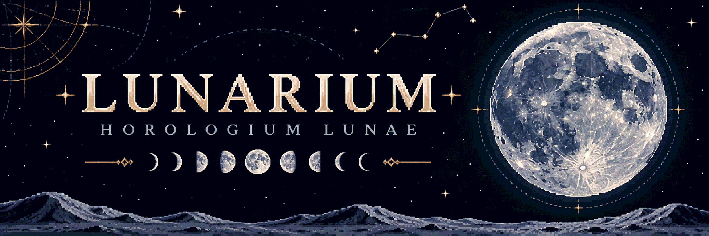
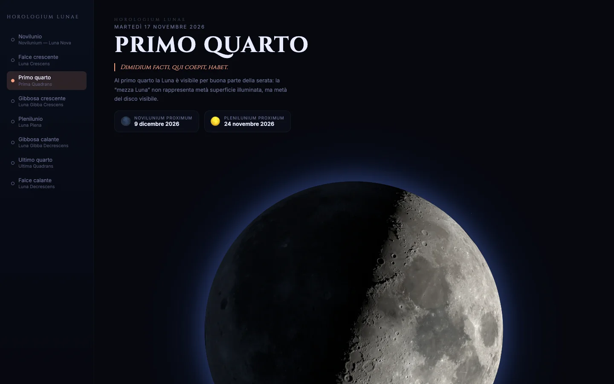
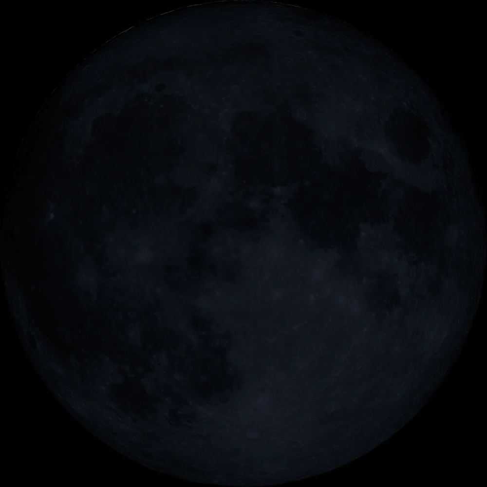
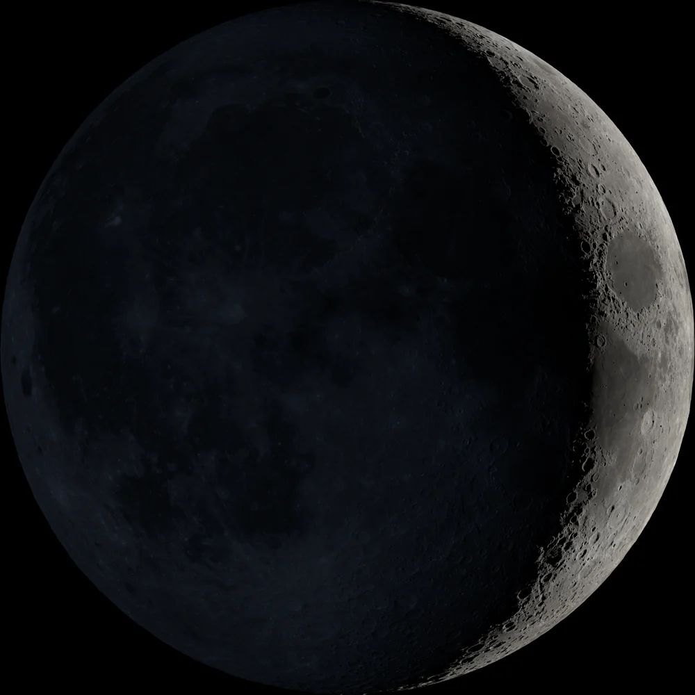
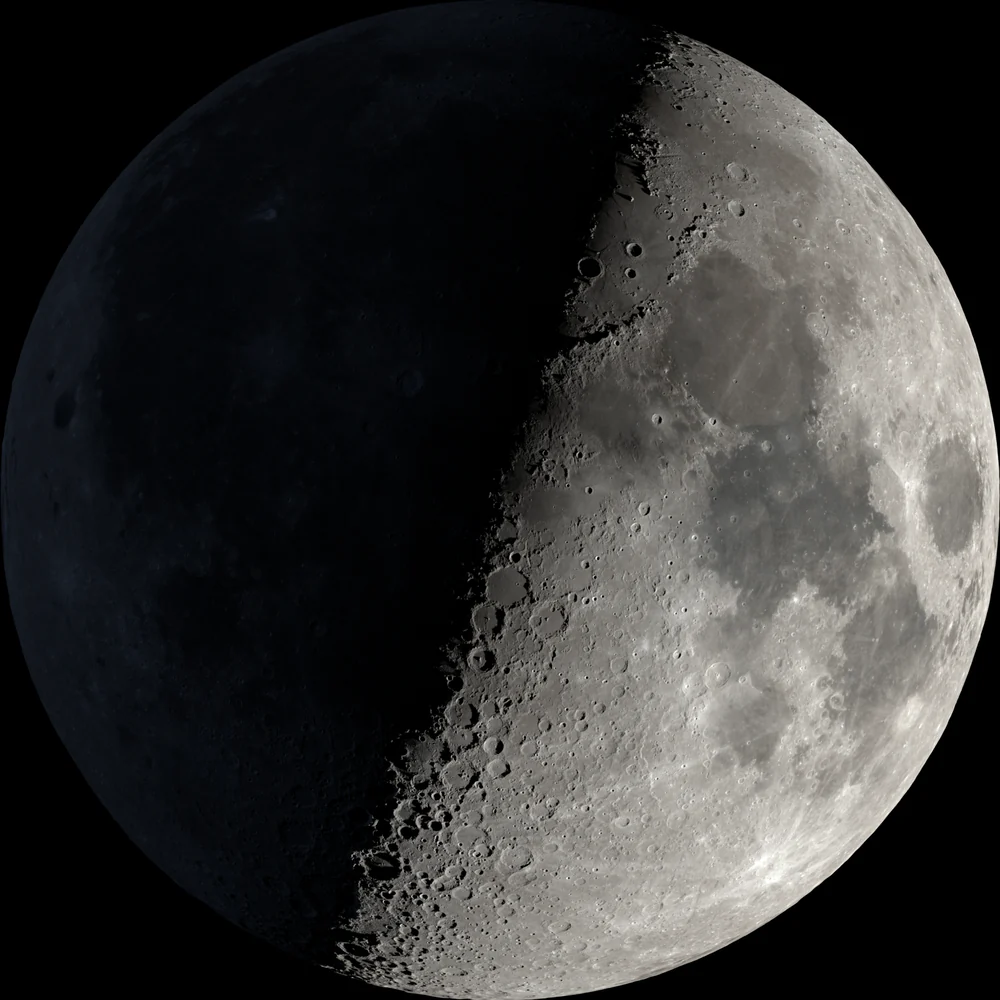
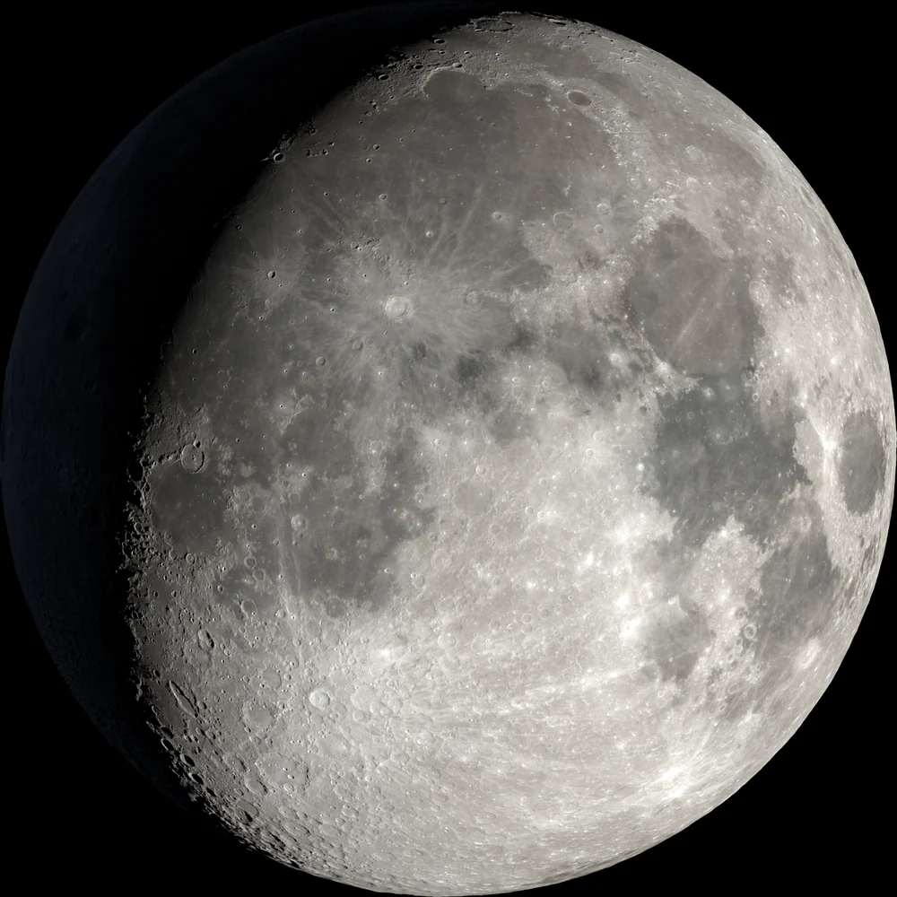
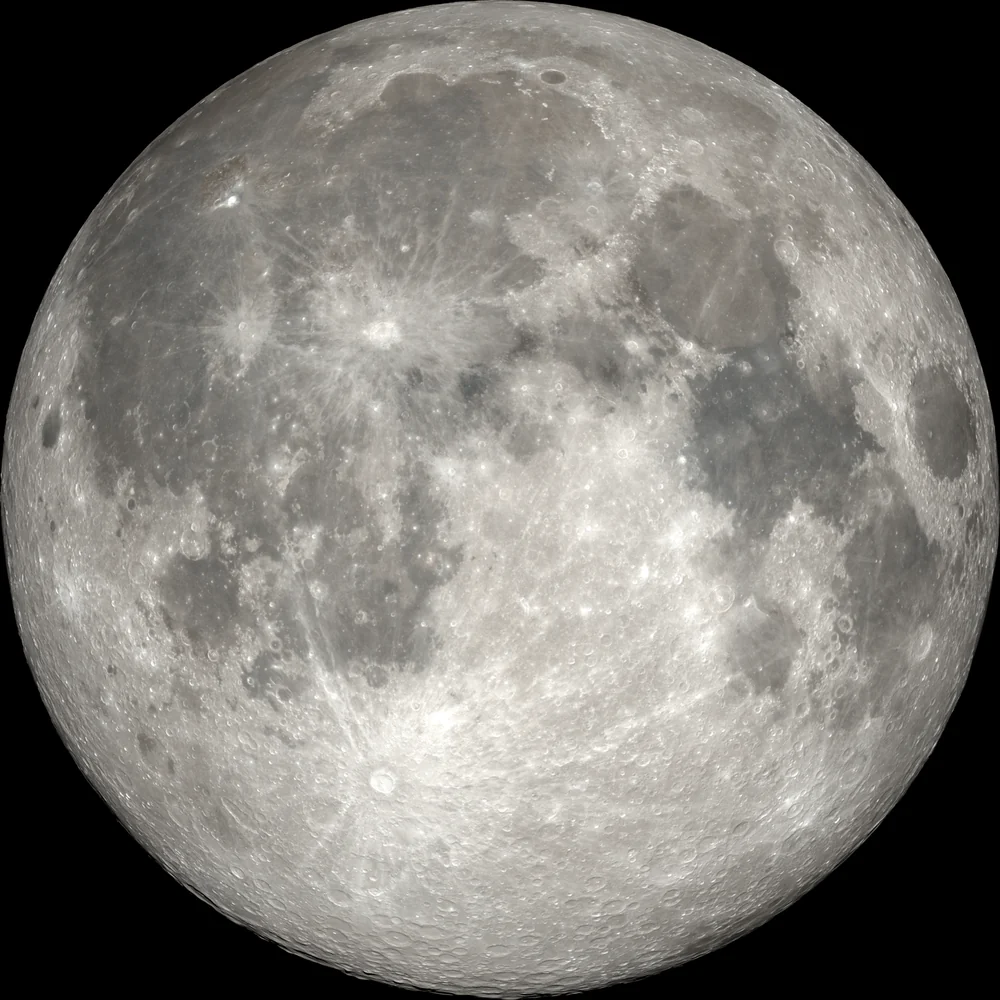
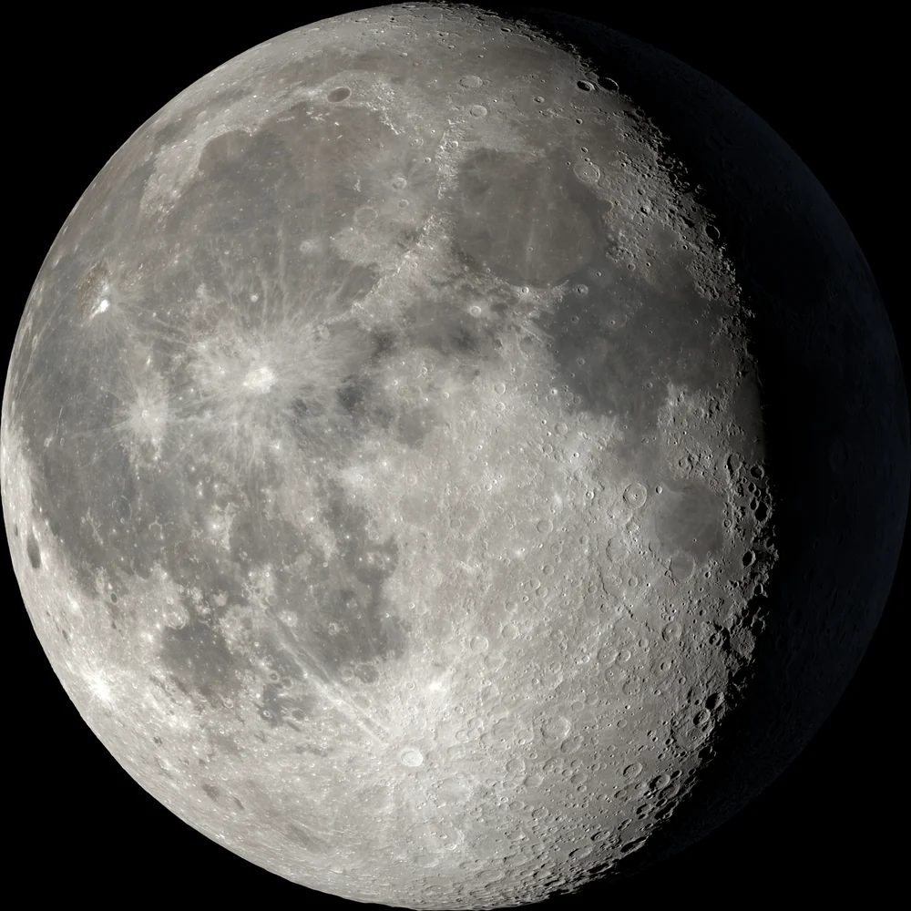
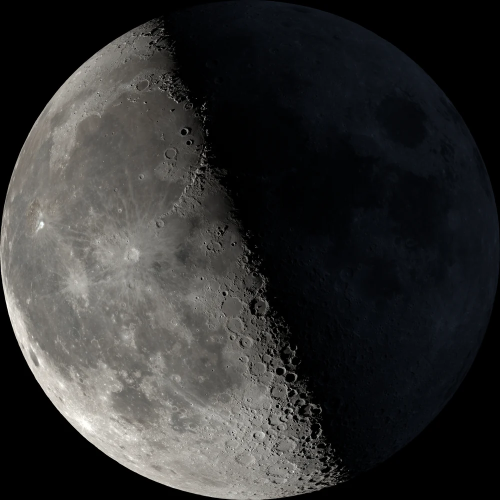
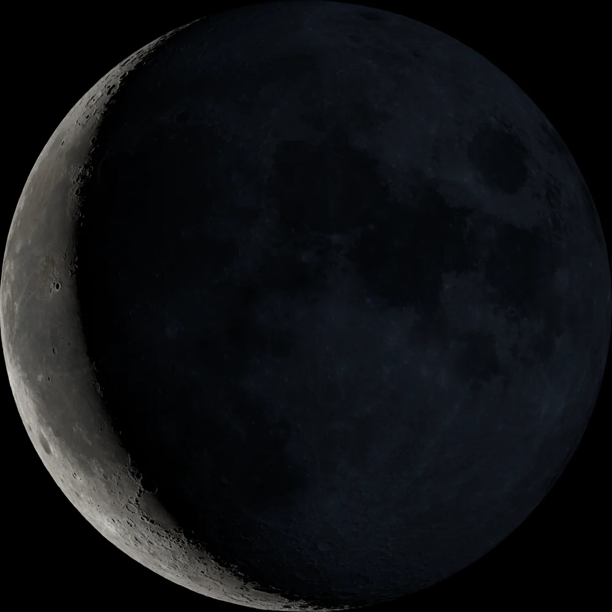

<div align="center">



# Lunarium

**Horologium Lunae, a moon clock for your browser.**<br>
Today's phase, the next new and full moon, and a Latin motto for every night.


### [Open Lunarium →](https://negimatare.github.io/)



</div>

<br>

Open the page and the moon is already there: **today's phase**, drawn from NASA imagery,
with its Italian name, a Latin motto and a short note on what you'll see in the sky.
Two cards count down to the **next new moon** (*Novilunium proximum*) and the **next full
moon** (*Plenilunium proximum*). On the day itself they simply say ***Hodie***, today.

The site speaks Italian, with Latin wherever the old astronomers would have used it.

---

## The eight phases

| | Fase | Latin | Motto |
|:-:|---|---|---|
|  | **Novilunio** | Novilunium, Luna Nova | *Ex nihilo lux oritur.* |
|  | **Falce crescente** | Luna Crescens | *Crescit occulta velut arbor aevo.* |
|  | **Primo quarto** | Prima Quadrans | *Dimidium facti, qui coepit, habet.* |
|  | **Gibbosa crescente** | Luna Gibba Crescens | *Paulatim summa petuntur.* |
|  | **Plenilunio** | Luna Plena | *Plena refulsit Luna, noctis regina.* |
|  | **Gibbosa calante** | Luna Gibba Decrescens | *Post lucem tenebrae, sed lux redit.* |
|  | **Ultimo quarto** | Ultima Quadrans | *Nox praeterit, dies autem adpropinquat.* |
|  | **Falce calante** | Luna Decrescens | *Finis unius principium alterius est.* |

---

## How it keeps time

| | |
|---|---|
| **Next new and full moon** | Computed from the true lunar phases (Meeus, *Astronomical Algorithms*, ch. 49), not an average month. Tested against the US Naval Observatory's 74 new and full moons of 2025–2027: the worst miss is under a minute. |
| **Your calendar, your day** | Dates follow your own timezone. The full moon of 24 November 2026, 14:53 UTC, is the 24th in Rome and Honolulu and already the 25th in Kiribati. |
| ***Hodie*** | Shown for the whole day of the event, the evening after it included. |
| **Today's phase** | One of eight phases from the moon's age, each 3.7 days wide. |
| **Privacy** | No cookies, no analytics, no third-party requests. Fonts are served by the site, and a strict Content Security Policy allows nothing else. |

---

## Under the hood

<details>
<summary><b>Structure</b></summary>

```
site/              everything GitHub Pages publishes
  index.html       Italian metadata, CSP, link preview
  css/             main.css, noscript.css
  js/main.js       the page: sidebar, today's phase, the two event cards
  js/lunar.js      the astronomy: phase index, true new and full moons
  assets/          moon/ (NASA frames), fonts/ (Inter, Cinzel), icons/, social/
tests/             node --test: phase pinning, USNO dates in several timezones
docs/readme/       images for this README
.github/workflows/ pages.yml (test, then deploy site/), codeql.yml
```

</details>

<details>
<summary><b>Development</b></summary>

```sh
npm test                                        # node --test, no dependencies
python3 -m http.server 8000 --directory site    # then open http://localhost:8000
```

Serve the folder over HTTP: the page loads ES modules, which browsers refuse from `file://`.

A pull request runs the tests and CodeQL. A merge to `main` runs them again and deploys `site/`
to GitHub Pages.

</details>

<details>
<summary><b>The moon images</b></summary>

Each phase comes from NASA's *Moon Phase and Libration, 2026* (3840×2160 frames), taken from
one lunation, 9 November to 9 December 2026, at the USNO phase times and halfway between them.
The disc is cut out along the frame's transparency, so every phase is the same size and
centred, then scaled to 1000×1000 WebP.

</details>

---

## Credits

- **Moon imagery**: NASA's Scientific Visualization Studio,
  [Moon Phase and Libration, 2026](https://svs.gsfc.nasa.gov/5587).
- **Phase times** for the tests: [US Naval Observatory](https://aa.usno.navy.mil/data/MoonPhases).
- **Fonts**: [Inter](https://github.com/rsms/inter) and [Cinzel](https://github.com/NDISCOVER/Cinzel),
  SIL Open Font License 1.1, in `site/assets/fonts/`.
- **Icons**: [Moon icons created by Freepik - Flaticon](https://www.flaticon.com/free-icons/moon).

Made by [negimatare](https://github.com/negimatare).
